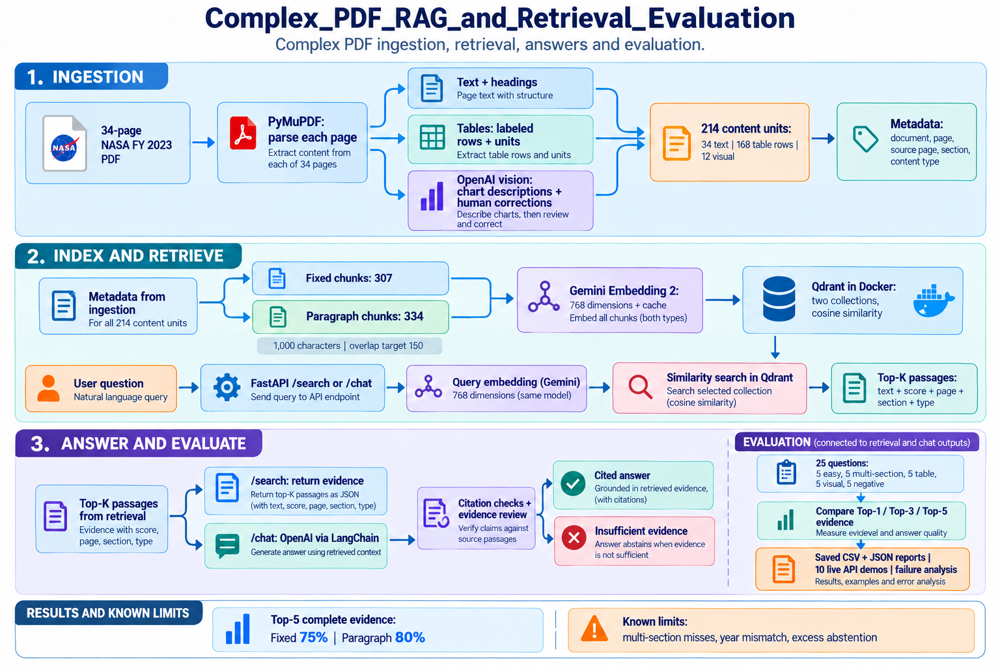
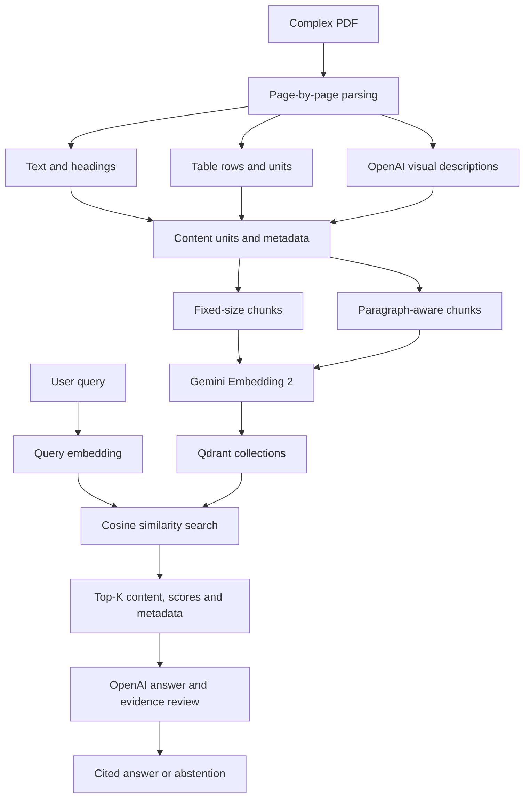

# Complex PDF RAG and Retrieval Evaluation

## Problem statement

Build and evaluate a retrieval-augmented generation application for
a complex PDF containing text, tables, charts, headings, and multiple
sections.

The project compares fixed-size and paragraph-aware chunking, retrieves
evidence with page-level citations, and investigates retrieval and
answer-generation failures.

## Technology stack

- Python 3.11
- FastAPI
- LangChain for OpenAI integration and paragraph-aware text splitting
- OpenAI for visual descriptions, answer generation, and evidence review
- Gemini Embedding 2 through the Google Gen AI SDK
- Qdrant running in Docker
- PyMuPDF for PDF processing

## Dataset

The dataset is a 34-page excerpt of the NASA Economic Impact Study
covering FY 2023.

The excerpt contains source pages 1–14 and 50–69.

It includes:

- Executive summaries
- NASA, Moon to Mars, and climate-research sections
- Economic-impact methodology
- Multi-page employment and procurement tables
- Charts and images
- Footnotes, headings, and page numbers

The PDF is complex because similar terms describe different measures,
such as direct NASA employment versus jobs supported throughout the
economy. Table continuations, financial units, chart percentages, and
source-page mapping also require careful handling.

The evaluated dataset is the selected excerpt, not the complete report.

File: `data/document.pdf`

## Architecture



## PDF processing

### Text

Each page is processed separately. Extracted text is saved with its
document name, excerpt page, source page, and section.

All 34 pages contained extractable text. This does not guarantee that
every reading-order or layout detail was extracted correctly.

### Tables

Tables are extracted using reviewed column layouts. Each row becomes
a separate content unit with its table title, state, column labels,
and units.

Eight table-page records produced 168 row units.

Selected values were checked against the PDF, including Alabama
employment, Maryland labor income, California procurement, and
Texas M2M employment.

The table parser is tailored to this document's layout. It is not a
universal table extractor.

### Images and charts

Candidate pages are rendered and sent to an OpenAI vision model.
Descriptions are cached.

Twelve visual records were retained. A Figure 5 description initially
contained incorrect percentages and was corrected through a persistent
manual override.

Visual descriptions are textual representations of images. This
implementation embeds those descriptions rather than raw images.

### Combined content

| Content type | Units |
|---|---:|
| Text | 34 |
| Table rows | 168 |
| Visual descriptions | 12 |
| Total | 214 |

## Metadata strategy

Example:

```json
{
  "document": "document.pdf",
  "page": 27,
  "source_page": 62,
  "section": "Data Analysis / NASA Employment",
  "content_type": "text",
  "unit_id": "text_p27"
}
```

Chunks also retain strategy, chunk ID, chunk index, and character count.
Table rows retain table and row identifiers.

`page` identifies the page in the 34-page excerpt.
`source_page` identifies its corresponding source-report page.

Sections use a reviewed page mapping. This is practical for the selected
excerpt but requires automation or additional review for larger PDFs.

A known limitation is that page-level section labels can be too broad:
the Figure 5 M2M visual on page 10 inherits a climate-research section label.

## Chunking strategies

Both strategies use a maximum of 1,000 characters and a configured
overlap of 150 characters.

The overlap setting is a target for paragraph-aware splitting; actual
overlap depends on the available boundaries.

| Property | Fixed | Paragraph |
|---|---:|---:|
| Total chunks | 307 | 334 |
| Text chunks | 116 | 142 |
| Table chunks | 168 | 168 |
| Visual chunks | 23 | 24 |
| Largest chunk | 1,000 | 1,000 |
| Average characters | 477.2 | 404.1 |
| Smallest chunk | 45 | 2 |

Fixed chunking can cut sentences and words.
Paragraph-aware chunking attempts to preserve natural text boundaries,
but can still split long paragraphs and produce small fragments.

Both strategies preserve all 214 source units.

## Embeddings and vector storage

Embedding model: `gemini-embedding-2`

- Output dimensions: 768
- Vectors are L2-normalized
- Document and query text use their respective retrieval prefixes
- Embeddings are cached to avoid repeat requests

Qdrant uses cosine distance and separate collections:

- `complex_pdf_fixed`: 307 points
- `complex_pdf_paragraph`: 334 points

Each point stores a vector, chunk text, and metadata.

Index manifests check that the local chunk data and embedding
configuration match the indexed collection.

Local Qdrant URL: `http://localhost:6335`

## Retrieval and answering

The Python retrieval interface is:

```python
search(query, top_k=5, strategy="paragraph")
```

Results contain:

- Retrieved text
- Similarity score
- Rank
- Excerpt and source page
- Section
- Content type
- Chunk ID and metadata

A similarity score measures vector similarity. It is not a probability
that a passage correctly answers the question.

The chat pipeline generates an answer from retrieved passages and checks
citations. A further model-based review checks support and evidence quotes.

These checks reduce some unsupported answers but do not guarantee correctness.

## Installation

Requirements:

- Python 3.11
- Docker Desktop
- Gemini API key
- OpenAI API key

From the project directory in PowerShell:

```powershell
py -3.11 -m venv venv
.\venv\Scripts\Activate.ps1
python -m pip install -r requirements.txt
Copy-Item .env.example .env
```

Enter your keys in `.env`. Never commit that file.

Start Qdrant:

```powershell
docker compose up -d
docker compose ps
```

## Execution

Process the supplied PDF:

```powershell
python ingestion\pdf_parser.py
python ingestion\table_parser.py
python ingestion\visual_parser.py
python ingestion\combine_content.py
```

Create and inspect chunks:

```powershell
python ingestion\fixed_chunking.py
python ingestion\paragraph_chunking.py
python ingestion\compare_chunks.py
```

Check embeddings and collections, then index:

```powershell
python retrieval\embeddings.py
python retrieval\vector_store.py
python -m ingestion.index_chunks --strategy fixed
python -m ingestion.index_chunks --strategy paragraph
```

Run a search:

```powershell
python -m retrieval.search --query "How many jobs nationwide did NASA support in FY 2023?" --strategy paragraph --top-k 5
```

Start the API:

```powershell
python -m uvicorn api:app --reload --host 127.0.0.1 --port 8000
```

Swagger UI: `http://127.0.0.1:8000/docs`

Endpoints:

- `GET /health`
- `POST /search`
- `POST /chat`

Example request:

```json
{
  "query": "How many jobs nationwide did NASA support in FY 2023?",
  "top_k": 5,
  "strategy": "paragraph"
}
```

## Sample retrieval output

Selected fields from the paragraph-strategy NASA employment search:

```json
{
  "rank": 2,
  "score": 0.8541088,
  "page": 4,
  "source_page": 4,
  "content_type": "text",
  "section": "Executive Summary / NASA",
  "text": "The total employment sustained by NASA across the U.S. is estimated to be 304,803 jobs."
}
```

The text above is an excerpt of the retrieved chunk.

For the Florida Figure 5 question, the correct visual evidence ranked
second with similarity 0.8382577. The first result was a table containing
a different employment-share measure.

## Evaluation methodology

The dataset contains 25 questions:

- 5 easy
- 5 multi-section
- 5 table
- 5 visual
- 5 negative

For answerable questions, an evidence group requires a matching page,
content type, and expected text fragments within a retrieved chunk.

Complete-evidence success requires every evidence group.
Negative questions are evaluated separately for abstention.

Commands:

```powershell
python -m evaluation.evaluate --validate-only
python -m evaluation.evaluate --strategy fixed
python -m evaluation.evaluate --strategy paragraph
python -m evaluation.inspect_failures
```

Evidence-label validation checks extracted content. It does not replace
manual verification against the PDF.

## Evaluation results

| Metric | Fixed | Paragraph |
|---|---:|---:|
| Complete evidence at Top 1 | 55% | 55% |
| Complete evidence at Top 3 | 70% | 70% |
| Complete evidence at Top 5 | 75% | 80% |
| Any evidence at Top 5 | 85% | 100% |
| Mean evidence recall at Top 5 | 80% | 90% |
| Negative abstention | 80% | 80% |

Complete evidence at Top 5 by category:

| Category | Fixed | Paragraph |
|---|---:|---:|
| Easy | 5/5 | 5/5 |
| Multi-section | 0/5 | 1/5 |
| Table | 5/5 | 5/5 |
| Visual | 5/5 | 5/5 |

Paragraph chunking improved complete retrieval from 15/20 to 16/20.

Questions requiring two different pages cannot achieve complete evidence
at Top 1 with page-bound chunks.

These are development-set results, not an independent held-out benchmark.
The five visual questions cover one reviewed chart.

Full evaluation tables and retrieved evidence are in `reports/`.

## Five weak retrieval cases

The following observations refer to fixed-size chunking.

| Case | Observed failure | Possible cause | Improvement to test |
|---|---|---|---|
| Q06: M2M versus climate jobs | Climate's 32,900 jobs retrieved; M2M's 96,479 missing | Direct M2M employment ranks above broader impact evidence | Separate searches for each program and measurement |
| Q07: NASA versus M2M jobs | Both required job totals missing | Results concentrate on M2M; similar table totals occupy multiple positions | Query decomposition and result diversification |
| Q08: Economic output | Both required output figures missing | General mission descriptions outrank quantitative summaries | Hybrid retrieval and reranking |
| Q09: Labor income | Both required income figures missing | Direct employee income is confused with economy-wide income | Add explicit measurement-scope metadata |
| Q10: Tax revenue | M2M's $2.9 billion found; NASA's $9.6 billion missing | One side of the comparison dominates retrieval | Retrieve evidence separately for both entities |

These causes are hypotheses supported by the observed passages, not
proven causal explanations.

Paragraph chunking recovered some missing evidence, but Q06–Q09 still
lacked complete evidence.

## Ten live demonstrations

Run the API, then:

```powershell
python -m evaluation.live_demo
```

Recorded paragraph-strategy results:

| ID | Query topic | Result |
|---|---|---|
| Q01 | NASA nationwide employment | Correct: 304,803; page 4 |
| Q05 | M2M nationwide employment | Correct: 96,479; page 7 |
| Q06 | M2M versus climate employment | Abstained: incomplete evidence |
| Q08 | NASA versus M2M economic output | Abstained: incomplete evidence |
| Q11 | Alabama NASA FTE jobs | Abstained: invalid reviewer evidence quotes |
| Q13 | California procurement total | Abstained: invalid reviewer evidence quotes |
| Q16 | Florida Figure 5 share | Correct: 37%; page 10 |
| Q20 | Texas Figure 5 share | Abstained: invalid reviewer evidence quotes |
| Q21 | Team-plan subscription price | Correctly abstained |
| Q24 | FY 2030 employment | Incorrectly answered with FY 2023 data |

All ten requests returned HTTP 200. This indicates successful request
processing, not answer correctness.

The full requests, answers, citations, and retrieved passages are saved
in `reports/live_demonstrations.json`.

## Additional answer failures

### Incompatible employment measures

An earlier answer compared 2,749 direct M2M FTEs with 32,900 broadly
supported climate-research jobs and concluded that climate research had
the larger impact.

Those measurements are not comparable. An added evidence review
subsequently blocked that comparison.

### Incorrect year

Q24 requested FY 2030. The application returned 304,803 jobs from the
FY 2023 report and labeled the number as FY 2030.

The evidence reviewer failed to reject the temporal mismatch.

### Excessive abstention

Q11, Q13, and Q20 were rejected because evidence quotes failed validation,
despite retrieval finding the expected evidence in the evaluation.

The responses do not preserve the rejected quotes, so the precise
validation mismatch needs further instrumentation.

## Good ingestion with poor retrieval

Correct facts may exist in the index but fail to enter the Top-K results.

This occurred for multi-section questions: retrieving a relevant page
did not necessarily retrieve the specific chunk containing its answer.

Better ranking, query decomposition, and evidence diversification can
address this problem.

## Poor ingestion with a good embedding model

If ingestion loses a table header, mixes financial units, removes a
reporting year, or invents a chart percentage, the embedding model
represents that incomplete or incorrect text.

Semantic similarity cannot reliably restore missing source facts.

The corrected Figure 5 description demonstrates why visual extraction
needs validation before embedding.

## Observations and problems faced

- Fixed chunks sometimes cut words and sentences.
- Paragraph splitting produced a two-character fragment.
- Similar vocabulary described incompatible measurements.
- Broad section labels did not always describe individual visuals.
- Visual descriptions required a manual correction.
- Repeated table totals occupied retrieval positions.
- Accurate retrieval did not guarantee that the reviewer would accept an answer.
- Real citations did not prevent an incorrect reporting-year claim.

## Improvements to test

- Propagate verified reporting-period metadata into every evidence passage.
- Require explicit support for requested years and measurement scopes.
- Log rejected reviewer quotes and validation outcomes.
- Decompose multi-section questions into focused searches.
- Retrieve more candidates, then rerank and diversify the final evidence.
- Add keyword retrieval for exact figures and table terminology.
- Improve heading detection and automate section mapping.
- Expand visual evaluation to additional charts.
- Evaluate on a separate held-out question set.

These improvements are proposed, not implemented in the reported baseline.

## Learning outcomes

- PDF ingestion requires separate treatment of text, tables, and visuals.
- Metadata preserves provenance and measurement context.
- Chunk boundaries influence retrieval quality.
- Retrieval and answer generation need separate evaluation.
- Similarity scores and valid citations are insufficient to prove correctness.
- Failure cases are useful evidence for deciding what to improve.

## Secrets and reproducibility

API keys are read from environment variables.

`.env`, virtual environments, and generated caches are excluded from Git.
`.env.example` contains placeholders only.

Published evaluation reports contain measured results from the baseline.
Later model calls may produce different answers or review decisions.